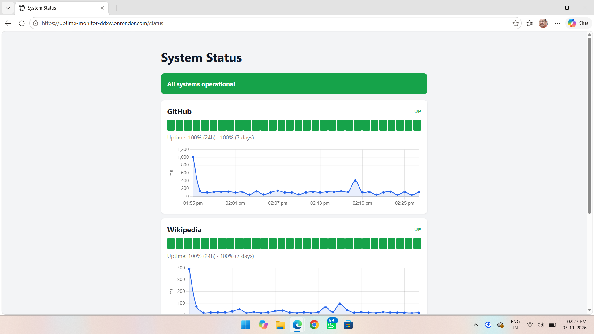
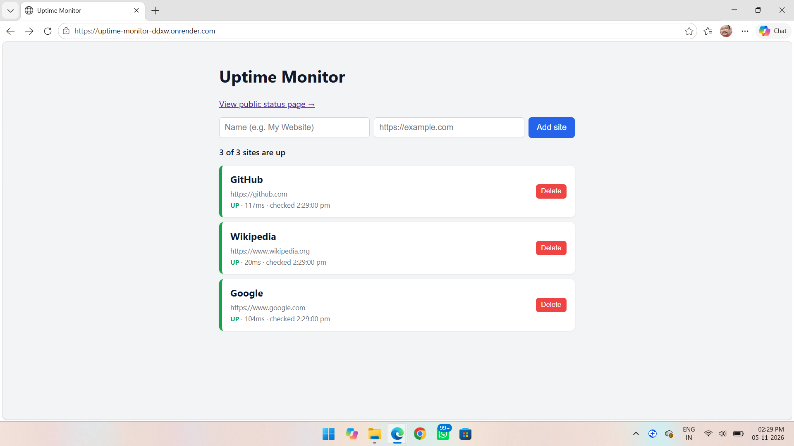
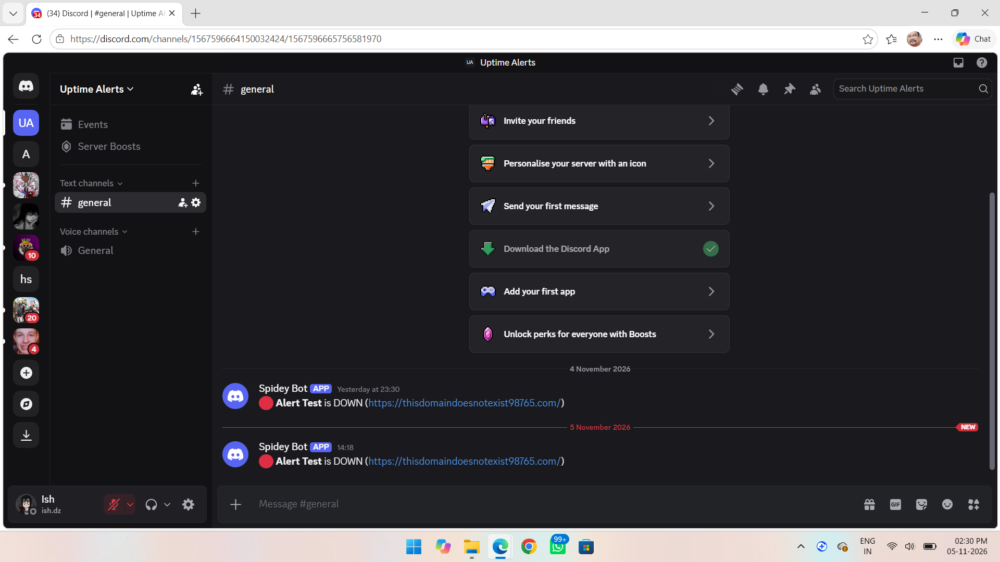

# Uptime Monitor

A self-built website monitoring tool with a public status page, response-time charts, and instant Discord alerts.

**Live demo:** https://uptime-monitor-ddxw.onrender.com/status

> The demo runs on a free hosting tier. If it has been idle, the first load can take up to a minute. History resets whenever the service is redeployed (see [Limitations](#limitations)).



## Features

- Checks every monitored site once a minute and records the status code and response time
- Treats timeouts (10 seconds), network errors, and non-2xx responses as "down"
- Public status page with an overall banner, a history bar for the last 30 checks, and 24-hour / 7-day uptime percentages
- Response-time line charts, with gaps where a site was down
- Discord alerts sent only when a site goes down or recovers, so a long outage does not spam the channel
- Password-protected admin dashboard for adding and removing monitored sites
- Public API exposes only safe data (no internal URLs or database IDs)

| Admin dashboard | Discord alert |
|---|---|
|  |  |

## Tech stack

- **Backend:** Node.js, Express
- **Database:** SQLite (better-sqlite3)
- **Scheduling:** node-cron
- **Frontend:** HTML, CSS, vanilla JavaScript, Chart.js
- **Alerts:** Discord webhooks
- **Hosting:** Render (free tier), kept awake with an external uptime pinger

## How it works

1. A scheduler runs every minute and requests each saved URL, with a 10-second timeout.
2. Each result (up/down, status code, response time) is saved to SQLite.
3. The monitor compares the new result with the previous one and sends a Discord message only when the status changes.
4. The browser fetches data from the JSON API and draws the dashboard and status page.

```
node-cron (every minute)
   -> fetch each URL
   -> save result to SQLite
   -> status changed? -> Discord webhook
Express server
   -> /api/*  JSON API
   -> /       admin dashboard (password)
   -> /status public status page
```

## Project structure

```
server.js     Express app, routes, admin password check
monitor.js    Scheduled checks and status-change detection
alerts.js     Discord webhook helper
db.js         SQLite setup and all queries
public/       Dashboard and status page (HTML, CSS, JS)
```

## Run it locally

Requires Node.js 24 (LTS recommended). Newer major versions may not have a prebuilt binary for `better-sqlite3` yet, which forces a slow native build that needs C++ build tools.

```bash
git clone https://github.com/ishajrc/uptime-monitor.git
cd uptime-monitor
npm install
```

Create a `.env` file from the example (`copy .env.example .env` on Windows, `cp .env.example .env` on macOS/Linux) and fill in your values:

```
DISCORD_WEBHOOK_URL=your-discord-webhook-url
ADMIN_PASSWORD=choose-a-password
```

Then start it:

```bash
npm start
```

- Admin dashboard: http://localhost:3000 (any username, plus your `ADMIN_PASSWORD`)
- Public status page: http://localhost:3000/status

If `ADMIN_PASSWORD` is empty, the admin page is not protected, which is fine for local use but not for a deployed site. If `DISCORD_WEBHOOK_URL` is empty, alerts are skipped.

## API

| Method | Route | Access | Description |
|---|---|---|---|
| GET | `/health` | Public | Lightweight check used by the keep-alive pinger |
| GET | `/status` | Public | Status page |
| GET | `/api/public-status` | Public | Sanitized status, uptime, history and chart data |
| GET | `/api/sites` | Admin | List monitored sites |
| POST | `/api/sites` | Admin | Add a site (`name`, `url`) |
| DELETE | `/api/sites/:id` | Admin | Remove a site and its history |
| GET | `/api/status` | Admin | Latest result for each site |
| GET | `/api/sites/:id/checks` | Admin | Recent check history for one site |

## Decisions and trade-offs

- **Alert on state change only:** comparing each result with the previous one avoids a message every minute during an outage.
- **Secrets stay out of the repo:** the webhook URL and admin password come from environment variables, and `.env` is git-ignored.
- **Parameterized SQL:** all queries use placeholders instead of string concatenation, which prevents SQL injection.
- **Safe DOM rendering:** user-entered names are inserted as text, not HTML, to prevent XSS.
- **Public API is sanitized:** the status page never receives the monitored URLs or internal IDs.
- **Demo data on startup:** because the free host wipes local storage, the app re-adds a few demo sites when the database is empty.

## Limitations

- **Ephemeral storage:** Render's free tier has a temporary filesystem, so SQLite history resets on every redeploy or restart. A production version would use a managed database such as PostgreSQL.
- **Free-tier sleeping:** free services sleep after a period without traffic, so an external pinger calls `/health` every 5 minutes to keep the monitor running.
- **Single failure triggers an alert:** one failed check is enough to send a "down" message, so a brief network blip can cause a false alarm.
- **Basic authentication only:** the admin area uses a single shared password. There are no user accounts.

## Future improvements

- Require 2 to 3 consecutive failures before alerting
- Persistent history with PostgreSQL
- Incident log with outage start time and duration
- Email alerts and per-site check intervals
- Automated tests for the check and alert logic

## Author

Built by **Ishal Jahamgeer C** — [GitHub](https://github.com/ishajrc) · [LinkedIn](https://linkedin.com/in/ishal-jahamgeer)
